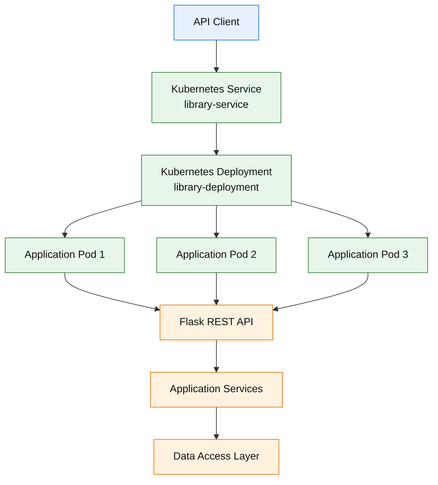
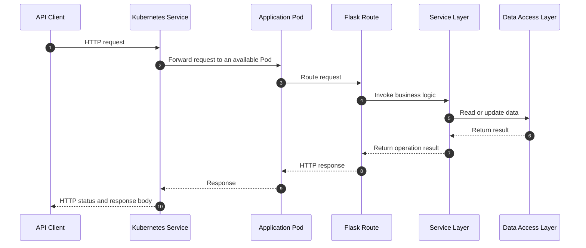
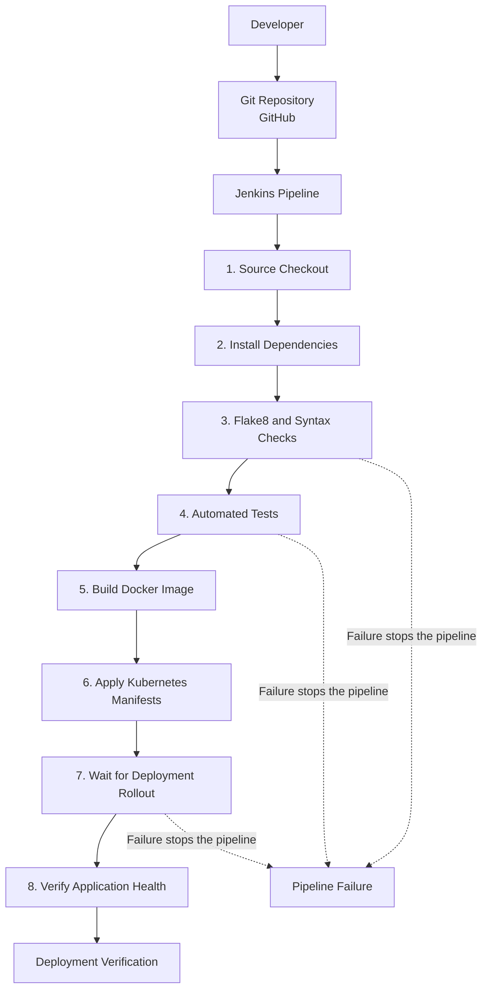
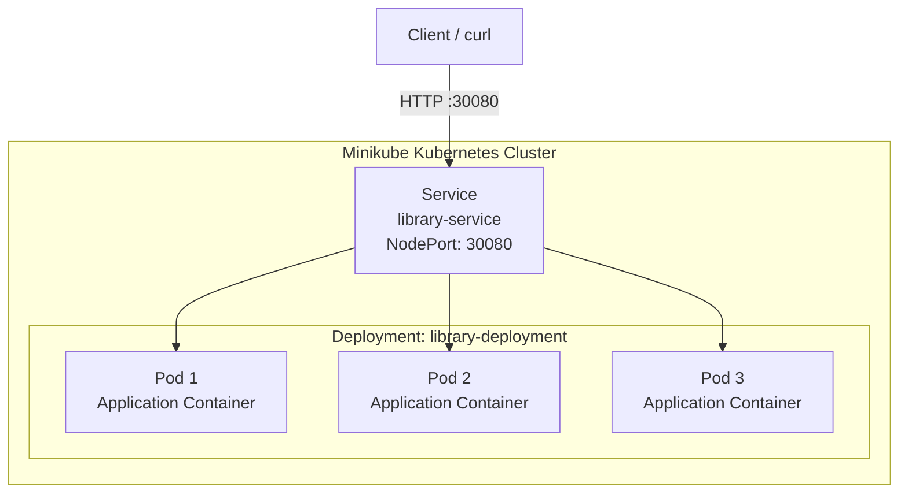
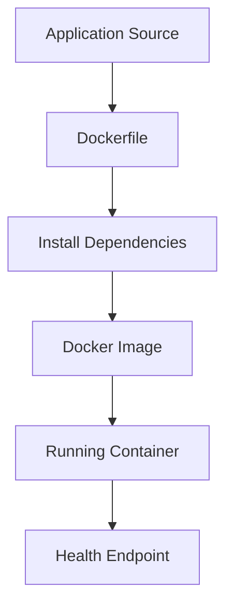
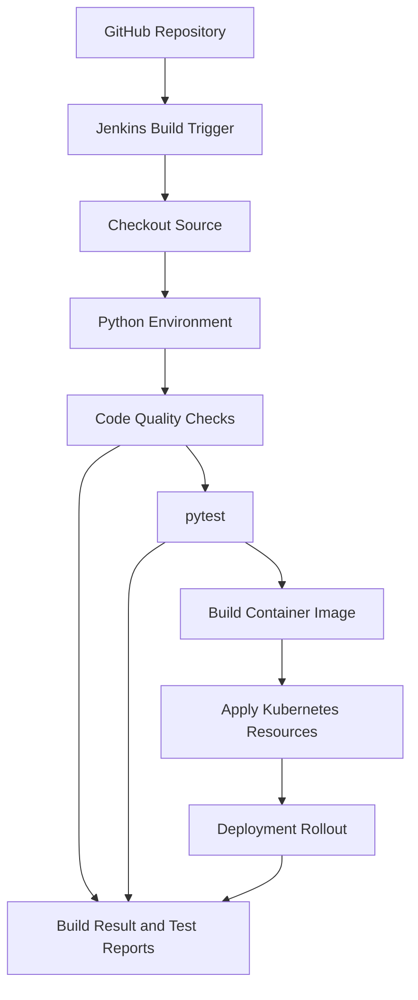

<div align="center">

# 📚 Enterprise Smart Library Management Platform

### A Containerized Library Management System with Automated Testing, CI/CD, and Kubernetes Deployment

[](https://www.python.org/)
[](https://flask.palletsprojects.com/)
[](https://www.docker.com/)
[](https://kubernetes.io/)
[](https://www.jenkins.io/)
[](https://pytest.org/)

**Build → Test → Package → Deploy → Verify**

A Python-based library management REST API designed to demonstrate software development,
automated testing, containerization, continuous integration, and Kubernetes deployment.

</div>

---

## 📑 Table of Contents

- [1. Project Overview](#-1-project-overview)
- [2. Problem Statement](#-2-problem-statement)
- [3. Project Objectives](#-3-project-objectives)
- [4. Key Features](#-4-key-features)
- [5. Technology Stack](#-5-technology-stack)
- [6. System Architecture](#-6-system-architecture)
- [7. Request Lifecycle](#-7-request-lifecycle)
- [8. DevOps CI/CD Architecture](#-8-devops-cicd-architecture)
- [9. Kubernetes Architecture](#-9-kubernetes-architecture)
- [10. Project Structure](#-10-project-structure)
- [11. Prerequisites](#-11-prerequisites)
- [12. Local Installation](#-12-local-installation)
- [13. Configuration](#-13-configuration)
- [14. Running the Application](#-14-running-the-application)
- [15. API Documentation](#-15-api-documentation)
- [16. Running Automated Tests](#-16-running-automated-tests)
- [17. Code Quality and Validation](#-17-code-quality-and-validation)
- [18. Docker Setup](#-18-docker-setup)
- [19. Kubernetes Deployment](#-19-kubernetes-deployment)
- [20. Jenkins CI/CD Pipeline](#-20-jenkins-cicd-pipeline)
- [21. Health Checks and Monitoring](#-21-health-checks-and-monitoring)
- [22. Security Considerations](#-22-security-considerations)
- [23. Troubleshooting](#-23-troubleshooting)
- [24. Known Limitations](#-24-known-limitations)
- [25. Future Improvements](#-25-future-improvements)
- [26. Learning Outcomes](#-26-learning-outcomes)
- [27. Author](#-27-author)
- [28. License](#-28-license)

---

# 📌 1. Project Overview

The **Enterprise Smart Library Management Platform** is a Python-based application
that provides REST API functionality for library management.

The project combines application development with DevOps practices to demonstrate
how an application can be developed, tested, packaged into a Docker image,
deployed to Kubernetes, and validated through automated checks.

Rather than focusing only on application code, the project demonstrates the
lifecycle of a deployable software service.

The application is built with Flask and includes library-related functionality
such as book management, user management, and borrowing and returning books.

The DevOps implementation includes:

- Python application development.
- REST API design.
- Automated testing with pytest.
- Code-quality validation with Flake8.
- Docker image creation.
- Kubernetes deployment and service exposure.
- Jenkins-based continuous integration and delivery.
- Application health checks.
- Deployment verification.

## Project Information

| Attribute | Details |
|---|---|
| Project Name | Enterprise Smart Library Management Platform |
| Application Type | REST API |
| Backend Framework | Flask |
| Programming Language | Python |
| Containerization | Docker |
| Container Orchestration | Kubernetes |
| Local Kubernetes Environment | Minikube |
| CI/CD Tool | Jenkins |
| Testing Framework | pytest |
| Code Quality Tool | Flake8 |
| Deployment Environment | Ubuntu-based AWS EC2 environment |
| Container Image | `library-management-platform` |
| Kubernetes Deployment | `library-deployment` |
| Kubernetes Service | `library-service` |
| Application Port | `5000` |
| Kubernetes NodePort | `30080` |

---

# 🎯 2. Problem Statement

Traditional library management processes can depend on manual registers,
spreadsheets, or disconnected applications.

These processes may make it difficult to maintain consistent records,
manage book availability, track borrowing activities, and verify whether
the application is functioning correctly.

A software-based library management system can provide a centralized
interface for these operations.

However, developing an application is only one part of delivering a reliable
software service. The application must also be tested, packaged, deployed,
and monitored.

This project addresses both sides of the problem:

1. Providing API functionality for library operations.
2. Demonstrating a repeatable DevOps workflow for deploying and validating
   the application.

## Proposed Solution

The platform uses Flask to expose API endpoints and Docker to package
the application and its runtime dependencies.

Jenkins automates validation and delivery tasks, while Kubernetes manages
the deployed application instances.

A health endpoint provides a simple way to verify application availability.

The resulting workflow demonstrates how application development and
infrastructure automation can be combined in a single project.

---

# 🎯 3. Project Objectives

The primary objectives are:

1. Develop a modular Flask application.
2. Expose library operations through REST API endpoints.
3. Organize application code into reusable modules.
4. Write automated tests for important application behavior.
5. Validate source-code quality before delivery.
6. Package the application as a Docker image.
7. Deploy the containerized application to Kubernetes.
8. Expose the application through a Kubernetes Service.
9. Automate validation and deployment through Jenkins.
10. Verify deployment health using HTTP responses and Kubernetes status.
11. Demonstrate basic application recovery through Kubernetes workload management.
12. Document the complete development and deployment workflow.

---

# ✨ 4. Key Features

## 4.1 Library Management

The application includes library-related API functionality.

Depending on the implemented endpoint, supported operations include:

- Retrieving book information.
- Listing available book records.
- Managing users.
- Borrowing books.
- Returning borrowed books.
- Validating borrowing-related business rules.
- Checking application health.

The exact behavior of each operation is defined by the corresponding
application route and service implementation.

## 4.2 REST API

The backend exposes HTTP endpoints that allow clients to communicate
with the application.

REST-style endpoints separate request handling from application logic
and make the service suitable for integration with other applications.

## 4.3 Automated Testing

pytest is used to test application behavior.

The test suite covers API behavior and library-related workflows, including
borrowing, returning, user management, and validation rules.

Automated tests help identify regressions before a new version is deployed.

## 4.4 Code Quality

Flake8 checks Python files for common style and code-quality problems.

Python compilation checks are also used to identify syntax errors.

## 4.5 Docker Containerization

Docker packages the application and its runtime dependencies into a
container image.

This improves consistency between development, testing, and deployment
environments.

## 4.6 Kubernetes Deployment

Kubernetes manages the application's deployed Pods.

The project uses a Deployment to manage replicas and a Service to expose
the application.

## 4.7 Jenkins Automation

Jenkins executes pipeline stages for source checkout, dependency installation,
code validation, automated testing, image building, and Kubernetes deployment.

The exact stages executed depend on the current Jenkinsfile and its
configured environment.

## 4.8 Health Verification

The `/api/health` endpoint provides an application health response.

It can be used to check whether the application is responding after
deployment or a rollout.

---

# 🛠️ 5. Technology Stack

| Technology | Purpose |
|---|---|
| Python 3.11 | Application runtime |
| Flask | REST API framework |
| pytest | Automated testing |
| pytest-cov | Test coverage reporting |
| Flake8 | Code-quality validation |
| Gunicorn | Production-oriented WSGI server dependency |
| Docker | Application containerization |
| Kubernetes | Container orchestration |
| Minikube | Local Kubernetes cluster |
| Jenkins | CI/CD automation |
| Git | Version control |
| GitHub | Remote source-code repository |
| Ubuntu | Deployment operating system |
| AWS EC2 | Cloud-hosted project environment |
| YAML | Kubernetes resource configuration |
| Bash | Automation and operational scripts |

**Note:** A dependency being installed does not necessarily mean it is used
by every application execution path. For example, verify the active
container startup command before describing Gunicorn as the server used
inside the container.

---

# 🏗️ 6. System Architecture

The following diagram shows the logical architecture of the project.



## Architecture Components

### API Client

A client sends HTTP requests to the application's API.

Possible clients include:

- curl.
- Postman.
- Automated test clients.
- Other applications that consume the API.

### Kubernetes Service

The Kubernetes Service provides a stable network endpoint for the application
Pods.

The configured NodePort is `30080`.

### Kubernetes Deployment

The Deployment describes the desired state of the application workload.

It manages the configured replica count and replaces Pods when Kubernetes
determines that replacement is required.

### Application Pods

Each Pod runs an instance of the containerized application.

The currently verified deployment uses three replicas.

### Flask REST API

Flask receives HTTP requests and routes them to the relevant application
handlers.

### Application Services

The service layer contains reusable business logic used by the API routes.

### Data Access Layer

The data access layer is responsible for interactions with the application's
configured data source.

The actual persistence behavior depends on the database configuration
and implementation included in the repository.

---

# 🔄 7. Request Lifecycle

The following diagram explains the normal request flow.



For example, a book-related request is received by Flask, routed to its
handler, processed by the relevant service, and returned to the client.

The exact data access operation depends on the endpoint being requested.

---

# ⚙️ 8. DevOps CI/CD Architecture

The project demonstrates an automated pipeline for validating and delivering
application changes.



## CI/CD Stages

| Stage | Responsibility |
|---|---|
| Source Checkout | Retrieves the source code |
| Environment Setup | Installs required Python dependencies |
| Static Validation | Checks Python code quality and syntax |
| Automated Testing | Executes the pytest suite |
| Image Build | Creates the application container image |
| Kubernetes Deployment | Applies the Kubernetes configuration |
| Rollout Verification | Waits for the Deployment to become available |
| Health Verification | Checks whether the application responds correctly |

The diagram represents the intended pipeline workflow. The exact commands
and stage names are determined by the current `Jenkinsfile`.

A successful Jenkins build demonstrates that the configured pipeline
completed its defined stages. It does not, by itself, guarantee that every
possible application behavior has been tested.

---

# ☸️ 9. Kubernetes Architecture

The application is deployed to a Kubernetes cluster managed by Minikube.



## Kubernetes Resources

### Deployment

**Resource name:** `library-deployment`

The Deployment manages the desired application replica count and provides
rolling-update and replacement behavior according to the configured
Kubernetes specification.

### Service

**Resource name:** `library-service`

The Service provides a stable endpoint for accessing the application.

### NodePort

**Configured port:** `30080`

The NodePort exposes the Service through the Minikube node's network address.

### Container Port

**Application port:** `5000`

The container exposes the port used by the Flask application.

## Verify Kubernetes Resources

```bash
kubectl get deployments
kubectl get pods -o wide
kubectl get services
kubectl get deployment library-deployment
kubectl describe deployment library-deployment
```

Check the Service configuration:

```bash
kubectl get service library-service
kubectl describe service library-service
```

Check the application logs:

```bash
kubectl logs deployment/library-deployment --tail=100
```

---

# 📂 10. Project Structure

The following is a logical overview of the main project components.
The exact files present in your working tree may differ.

```text
library-management-platform/
│
├── app/
│   ├── __init__.py
│   ├── models/
│   │   ├── __init__.py
│   │   ├── book.py
│   │   └── user.py
│   │
│   ├── routes/
│   │   ├── __init__.py
│   │   └── api.py
│   │
│   └── services/
│       ├── __init__.py
│       └── library_service.py
│
├── database/
│   ├── __init__.py
│   ├── db.py
│   └── migrations/
│
├── k8s/
│   └── deployment.yaml
│
├── tests/
│   ├── conftest.py
│   └── test_*.py
│
├── .dockerignore
├── .gitignore
├── Dockerfile
├── Jenkinsfile
├── requirements.txt
├── run.py
└── README.md
```

Some files shown above may be optional or may not exist in every revision.
Use the actual repository tree as the final authority.

## Directory Responsibilities

### `app/`

Contains the Flask application and application modules.

### `app/models/`

Contains model definitions associated with library entities such as books
and users.

### `app/routes/`

Contains API route definitions and request-handling logic.

### `app/services/`

Contains reusable business logic for library operations.

### `database/`

Contains database-related code and migrations where implemented.

### `k8s/`

Contains Kubernetes resource manifests used for deployment.

### `tests/`

Contains automated tests for application functionality.

### `Dockerfile`

Defines how the application container image is built.

### `Jenkinsfile`

Defines the Jenkins pipeline.

### `requirements.txt`

Lists Python package dependencies.

### `run.py`

Provides the application entry point.

### `.dockerignore`

Excludes unnecessary files from the Docker build context.

### `.gitignore`

Excludes files that should not be tracked by Git.

---

# 💻 11. Prerequisites

To run the project locally, install the following:

- Python 3.11.
- Git.
- pip.
- A terminal or command-line environment.

For containerization and deployment, you will also need:

- Docker.
- kubectl.
- Minikube or another Kubernetes cluster.
- Jenkins, if you want to run the CI/CD pipeline.

Verify your installations:

```bash
python3 --version
git --version
docker --version
kubectl version --client
minikube version
```

The Docker, Kubernetes, and Jenkins tools are only required for their
respective workflows; they are not all necessary to run the Flask API locally.

---

# 🚀 12. Local Installation

## Step 1: Clone the Repository

```bash
git clone https://github.com/Akash-Dhanwate/library-management-platform.git
cd library-management-platform
```

## Step 2: Create a Virtual Environment

On Linux or macOS:

```bash
python3 -m venv venv
```

Activate the environment:

```bash
source venv/bin/activate
```

## Step 3: Upgrade pip

```bash
python -m pip install --upgrade pip
```

## Step 4: Install Dependencies

```bash
pip install -r requirements.txt
```

## Step 5: Validate the Installation

```bash
python -m compileall -q app database tests run.py
```

If compilation completes without errors, the Python files pass this
basic syntax-compilation check.

## Step 6: Run the Application

```bash
python run.py
```

Use the application's configured host and port when accessing it.

For the configured deployment, the application listens on port `5000`.

---

# 🔧 13. Configuration

Application configuration depends on the values expected by the current
source code.

If the application uses environment variables, configure them before
starting the application.

For example, a local environment file could contain:

```dotenv
# Example configuration template.
# Replace these examples with the variables actually read by the application.

FLASK_DEBUG=false
PORT=5000
```

This example is a template, not a guarantee that every variable is consumed
by the application.

## Configuration Best Practices

- Do not commit passwords or API tokens.
- Do not store production secrets directly in the Docker image.
- Keep environment-specific settings outside application code.
- Use Kubernetes Secrets for sensitive deployment configuration when needed.
- Keep local development configuration separate from deployment configuration.
- Document every environment variable that is actually supported by the code.

If database configuration is required, use the variable names expected by
`database/db.py` and the relevant database initialization code.

---

# ▶️ 14. Running the Application

## Start the Flask Application

```bash
python run.py
```

## Test the Health Endpoint

```bash
curl -i http://127.0.0.1:5000/api/health
```

A verified deployment returned a response similar to:

```json
{
  "service": "Enterprise Smart Library Management Platform",
  "status": "UP",
  "version": "1.0.1"
}
```

The exact version value depends on the application revision being executed.

## Stop the Application

Press:

```text
Ctrl + C
```

---

# 🌐 15. API Documentation

The platform exposes HTTP API endpoints through Flask.

The route implementation in `app/routes/api.py` is the authoritative
source for endpoint paths, methods, parameters, validation, and response
formats.

## 15.1 Health Check

**Endpoint**

```http
GET /api/health
```

**Purpose**

Returns application health information.

**Example**

```bash
curl -i http://127.0.0.1:5000/api/health
```

**Example response**

```json
{
  "service": "Enterprise Smart Library Management Platform",
  "status": "UP",
  "version": "1.0.1"
}
```

**Expected status:** `200 OK` when the application is healthy.

## 15.2 Book Operations

The project includes book-related API functionality.

Consult `app/routes/api.py` for the exact book endpoint paths and supported
HTTP methods.

Typical operations in a library API include:

- Listing books.
- Retrieving book information.
- Checking book availability.

Do not assume that every operation listed above has a dedicated endpoint
unless it exists in the current implementation.

## 15.3 User Operations

The application includes user-management functionality.

The implemented API includes a user-creation route.

Consult `app/routes/api.py` to verify the precise request schema,
response structure, and behavior for invalid or duplicate users.

## 15.4 Borrow and Return Operations

The application includes borrowing and returning workflows.

These operations should be tested against the rules implemented in the
service layer.

Depending on the configured business rules, validation may include:

- Whether a book can be borrowed.
- Whether a borrowing operation is valid.
- Whether a return operation is permitted.
- Whether user borrowing limits are respected.

The exact validation rules are defined by the current application code.

## 15.5 API Endpoint Reference

Use this table as a checklist when documenting the final endpoint inventory.

| Operation | HTTP Method | Endpoint | Purpose |
|---|---|---|---|
| Health check | GET | `/api/health` | Verify application health |
| List books | GET | Verify in `app/routes/api.py` | Retrieve book records |
| Create user | POST | Verify in `app/routes/api.py` | Create a user |
| Borrow book | Verify in `app/routes/api.py` | Verify in `app/routes/api.py` | Borrowing workflow |
| Return book | Verify in `app/routes/api.py` | Verify in `app/routes/api.py` | Returning workflow |

**Important:** Replace the verification notes with the actual route paths and
methods before treating this table as a complete API contract.

For each implemented endpoint, useful documentation includes:

1. HTTP method.
2. Endpoint path.
3. Required headers.
4. Request body, if any.
5. Successful response.
6. Error responses.
7. Validation rules.
8. Relevant automated tests.

---

# 🧪 16. Running Automated Tests

The project uses pytest for automated testing.

## Run All Tests

Activate the virtual environment first, then run:

```bash
python -m pytest -v
```

## Run Tests with Coverage

```bash
python -m pytest --cov=app --cov=database --cov-report=term-missing
```

## Generate an HTML Coverage Report

```bash
python -m pytest \
  --cov=app \
  --cov=database \
  --cov-report=html
```

The HTML report is generated in:

```text
htmlcov/
```

Open `htmlcov/index.html` in a browser to inspect the report.

## Test Coverage Areas

The project's tests include library and API behavior.

Relevant areas include:

- Health endpoint behavior.
- Book listing.
- Borrowing and returning workflows.
- User creation.
- Duplicate-user validation.
- User deletion behavior.
- Borrowing-related validation rules.

The exact coverage depends on the current test files.

## Example Test Output

A previously verified test run completed with:

```text
11 passed
```

This is a historical result, not a guarantee that every future revision
will produce the same outcome.

Always rerun the tests after making code changes.

---

# 🧹 17. Code Quality and Validation

The project uses Flake8 for Python code-quality checks.

## Run Flake8

```bash
python -m flake8 app database tests run.py --count --statistics
```

A previously verified run returned:

```text
0
```

This indicates that Flake8 reported zero findings for the files checked
in that run.

## Run Python Compilation Checks

```bash
python -m compileall -q app database tests run.py
```

## Check Git Whitespace Errors

```bash
git diff --check
```

## Recommended Validation Order

Run validation before building the Docker image:

```bash
python -m compileall -q app database tests run.py

python -m flake8 app database tests run.py --count --statistics

python -m pytest -v

git diff --check
```

A command that completes without an error is useful evidence, but each
check validates a different aspect of the project.

---

# 🐳 18. Docker Setup

Docker packages the application and its dependencies into a container image.

The project includes a `Dockerfile` that defines the runtime environment,
dependency installation, application files, and startup command.

## 18.1 Build the Docker Image

From the project root:

```bash
docker build -t library-management-platform:v1.0.1 .
```

## 18.2 Verify the Image

```bash
docker images library-management-platform
```

## 18.3 Run the Container

```bash
docker run --rm -p 5000:5000 library-management-platform:v1.0.1
```

The command maps port `5000` on the host to port `5000` inside the container.

If port `5000` is already occupied, choose another host port:

```bash
docker run --rm -p 8081:5000 library-management-platform:v1.0.1
```

Then test the API using:

```bash
curl -i http://127.0.0.1:8081/api/health
```

The alternative host port does not change the application's internal port.

## 18.4 Inspect Container Logs

```bash
docker ps
docker logs <container_id>
```

Replace `<container_id>` with the ID returned by `docker ps`.

## 18.5 Stop a Running Container

```bash
docker stop <container_id>
```

## Docker Build Workflow



## Docker Best Practices

- Keep the build context small.
- Exclude virtual environments and caches using `.dockerignore`.
- Avoid copying credentials into the image.
- Use a non-root application user where supported.
- Pin dependency versions where appropriate.
- Rebuild and retest the image after source changes.
- Use explicit image tags for reproducibility.
- Verify the startup command and health-check behavior.

---

# ☸️ 19. Kubernetes Deployment

The project uses Kubernetes to deploy the containerized application.

The Kubernetes configuration is maintained in the `k8s/` directory.

The main deployment manifest is:

```text
k8s/deployment.yaml
```

## 19.1 Start Minikube

If Minikube is not already running:

```bash
minikube start
```

Verify the cluster:

```bash
minikube status
kubectl get nodes
```

## 19.2 Build the Image for Minikube

For a Minikube environment using Docker as its container runtime,
the following command makes Docker commands target Minikube's Docker daemon:

```bash
eval "$(minikube docker-env)"
```

Build the image:

```bash
docker build -t library-management-platform:v1.0.1 .
```

**Important:** This workflow is specific to Minikube configurations that
support `minikube docker-env`. If your Minikube runtime differs, use the
image-loading or image-publishing workflow appropriate for that runtime.

## 19.3 Apply Kubernetes Manifests

```bash
kubectl apply -f k8s/deployment.yaml
```

If the Service is defined in the same manifest, it will be applied too.

## 19.4 Wait for the Deployment

```bash
kubectl rollout status deployment/library-deployment
```

## 19.5 Check the Pods

```bash
kubectl get pods -o wide
```

## 19.6 Check the Service

```bash
kubectl get service library-service
```

## 19.7 Test the Deployed Application

For the configured NodePort service:

```bash
curl -i "http://$(minikube ip):30080/api/health"
```

The deployed application previously returned HTTP `200 OK` and reported
its service status as `UP`.

## 19.8 Inspect Logs

```bash
kubectl logs deployment/library-deployment --tail=100
```

## 19.9 Describe a Pod

```bash
kubectl describe pod <pod_name>
```

Replace `<pod_name>` with an actual Pod name.

## 19.10 Verify the Deployed Image

```bash
kubectl get deployment library-deployment \
  -o jsonpath='{.spec.template.spec.containers[*].image}'

echo
```

Check the desired and available replicas:

```bash
kubectl get deployment library-deployment
```

## 19.11 Update the Application Image

After building a new image, update the Deployment.

For example:

```bash
kubectl set image deployment/library-deployment \
  <container_name>=library-management-platform:v1.0.1
```

Replace `<container_name>` with the actual container name defined in
`k8s/deployment.yaml`.

Then monitor the rollout:

```bash
kubectl rollout status deployment/library-deployment
```

For reproducible deployments, keep the image tag in the Kubernetes manifest
consistent with the tag built by the Jenkins pipeline.

## 19.12 Roll Back a Deployment

If a rollout causes problems and a previous revision exists:

```bash
kubectl rollout history deployment/library-deployment
```

Roll back to the previous revision:

```bash
kubectl rollout undo deployment/library-deployment
```

Verify the result:

```bash
kubectl rollout status deployment/library-deployment
kubectl get pods
```

## 19.13 Kubernetes Cleanup

To remove the resources defined in the manifest:

```bash
kubectl delete -f k8s/deployment.yaml
```

This deletes the resources defined in that file. Review the manifest before
running the command in an environment containing other workloads.

---

# 🔁 20. Jenkins CI/CD Pipeline

Jenkins automates the validation and deployment workflow.

The pipeline definition is stored in:

```text
Jenkinsfile
```

## Pipeline Responsibilities

The configured workflow is designed to perform tasks such as:

1. Checking out source code.
2. Preparing a Python environment.
3. Installing project dependencies.
4. Running Flake8 and syntax checks.
5. Executing automated tests.
6. Building a Docker image.
7. Applying Kubernetes manifests.
8. Waiting for the Deployment rollout.

The precise behavior depends on the current Jenkinsfile and the permissions
and configuration of the Jenkins runtime.

## Pipeline Architecture



## Configure Jenkins

The exact configuration depends on how Jenkins was installed.

At a high level:

1. Open the Jenkins dashboard.
2. Create or open the pipeline job.
3. Configure the GitHub repository.
4. Ensure Jenkins can check out the repository.
5. Ensure the Jenkins runtime has access to the required Python tools.
6. Configure Docker access for the Jenkins runtime.
7. Configure Kubernetes access using the intended kubeconfig.
8. Ensure the required image tag matches the Kubernetes manifest.
9. Run the pipeline.
10. Inspect the console output and test reports.

## Jenkins and Kubernetes Permissions

The Jenkins process must have appropriate access to the tools and cluster
used by the pipeline.

A configuration that works for the interactive Ubuntu user may not work
for the Jenkins service account.

Validate these separately:

```bash
sudo -u jenkins kubectl get nodes
sudo -u jenkins kubectl get deployments
```

These commands assume that the Jenkins service account is named `jenkins`
and that the appropriate Kubernetes configuration is accessible to it.

If they fail, investigate the Jenkins user's kubeconfig, cluster context,
file permissions, and environment before changing permissions broadly.

## CI/CD Verification Checklist

- [ ] Jenkins can access the repository.
- [ ] Source checkout succeeds.
- [ ] Dependencies install successfully.
- [ ] Flake8 completes successfully.
- [ ] Automated tests pass.
- [ ] Docker image builds successfully.
- [ ] Kubernetes manifests apply successfully.
- [ ] The rollout completes successfully.
- [ ] The health endpoint responds successfully.
- [ ] Test results are available in Jenkins.

A green build is evidence that the configured pipeline stages completed.
The deployed application's health and functionality should still be verified
independently.

---

# ❤️ 21. Health Checks and Monitoring

Health checks help determine whether an application is responding.

## Application Health Check

```bash
curl -i http://127.0.0.1:5000/api/health
```

For the Kubernetes deployment:

```bash
curl -i "http://$(minikube ip):30080/api/health"
```

## Kubernetes Workload Status

```bash
kubectl get deployments
kubectl get pods
kubectl get services
```

## Application Logs

```bash
kubectl logs deployment/library-deployment --tail=100
```

## Deployment Events

```bash
kubectl describe deployment library-deployment
```

## Important Monitoring Distinction

An HTTP health endpoint returning `200 OK` confirms that the endpoint
responded successfully.

It does not automatically prove that:

- All business operations work correctly.
- A database is available.
- Data is persisted safely.
- Every dependency is healthy.
- The application is secure under production traffic.

For stronger production monitoring, add dependency-aware readiness checks,
structured logs, metrics, alerting, and external monitoring.

---

# 🔐 22. Security Considerations

Security should be considered throughout development and deployment.

## Source Code and Credentials

- Never commit passwords, access tokens, private keys, or production secrets.
- Use environment-specific configuration.
- Store sensitive values in an appropriate secret manager.
- Rotate credentials that may have been exposed.
- Review Git history before publishing a repository containing secrets.

## Container Security

- Use a non-root application user where possible.
- Keep the base image and dependencies updated.
- Avoid including development files and credentials in the image.
- Scan images for known vulnerabilities.
- Use explicit image tags.
- Avoid running containers with unnecessary privileges.

## Kubernetes Security

- Use least-privilege access controls.
- Avoid granting cluster-admin permissions to application workloads.
- Store sensitive configuration in Kubernetes Secrets or an appropriate
  external secret manager.
- Restrict externally exposed services to the required network scope.
- Use resource requests and limits.
- Configure appropriate readiness and liveness probes.
- Review Pod security settings.

## API Security

For a production deployment, consider:

- Authentication.
- Role-based authorization.
- Input validation.
- Consistent error handling.
- Rate limiting.
- Audit logging.
- HTTPS.
- Protection against unauthorized data access.

These are security recommendations, not claims that every control is
already implemented in the current project.

---

# 🛠️ 23. Troubleshooting

## Problem 1: Port 5000 Is Already in Use

Identify the process listening on port `5000`:

```bash
sudo lsof -i :5000
```

If `lsof` is unavailable:

```bash
sudo ss -ltnp | grep ':5000'
```

Stop only the process you have identified and confirmed is safe to stop.

Alternatively, use another host port when running Docker:

```bash
docker run --rm -p 8081:5000 library-management-platform:v1.0.1
```

## Problem 2: Docker Build Fails

Inspect the build output:

```bash
docker build --no-cache -t library-management-platform:v1.0.1 .
```

Check:

- Docker daemon status.
- Dockerfile instructions.
- Dependency compatibility.
- Internet access for package installation.
- Available disk space.
- `.dockerignore` rules.

## Problem 3: Kubernetes Pods Are Not Ready

Check the workload:

```bash
kubectl get pods -o wide
```

Inspect a Pod:

```bash
kubectl describe pod <pod_name>
```

Inspect logs:

```bash
kubectl logs <pod_name>
```

Check recent cluster events:

```bash
kubectl get events --sort-by=.metadata.creationTimestamp
```

Common causes include:

- An image that cannot be found.
- An invalid container command.
- Missing configuration.
- Application startup errors.
- Failed health probes.
- Insufficient cluster resources.

## Problem 4: The Kubernetes Service Is Not Reachable

Inspect the Service:

```bash
kubectl get service library-service
kubectl describe service library-service
```

Verify that Pods are ready:

```bash
kubectl get pods
```

Check the Minikube address:

```bash
minikube ip
```

Test the endpoint:

```bash
curl -i "http://$(minikube ip):30080/api/health"
```

If the command fails, check the Service selector, target port, Pod labels,
container port, and application listening address.

## Problem 5: Jenkins Cannot Access Kubernetes

Check which user runs Jenkins:

```bash
ps -ef | grep '[j]enkins'
```

Inspect Kubernetes access as that user:

```bash
sudo -u jenkins kubectl get nodes
```

A successful `kubectl` command for the Ubuntu login user does not prove
that Jenkins has the same configuration.

Check the Jenkins runtime's:

- `KUBECONFIG` environment variable.
- Kubernetes context.
- kubeconfig permissions.
- Network access.
- Minikube cluster configuration.

## Problem 6: Tests Fail

Run the test suite with detailed output:

```bash
python -m pytest -vv
```

Inspect the traceback and failing assertion.

If the tests depend on a database, verify that the required database service
and test configuration are available.

Do not run destructive database setup or migration commands against
production data while troubleshooting.

## Problem 7: Git Push Requests a Password

GitHub HTTPS authentication does not accept an account password as a
replacement for a Personal Access Token.

Use an appropriately scoped token at the password prompt, or configure SSH
authentication.

Never place the token directly in a Git remote URL or commit it to the
repository.

---

# ⚠️ 24. Known Limitations

This project is a DevOps learning and demonstration project. The following
areas should be evaluated before using it in a real production environment.

## Production Readiness

A successful local deployment or Kubernetes rollout does not, by itself,
establish production readiness.

## Data Persistence

Confirm the active data backend and persistence configuration before relying
on the application for long-term records.

If the application uses in-memory storage for any operations, those records
may not survive a process restart or Pod replacement.

Persistent production data should use an appropriately configured database
or storage system.

## Authentication and Authorization

Verify whether authentication and authorization are implemented for every
sensitive operation.

An API that lacks access controls should not be exposed publicly with
real user data.

## API Documentation

The endpoint reference should be completed against the actual route
definitions and request schemas.

## Monitoring

The health endpoint provides a basic availability check. Production
deployments need additional monitoring and alerting.

## High Availability

Multiple replicas improve workload redundancy, but full high availability
also depends on cluster capacity, networking, persistent storage, application
behavior, and the failure modes of external dependencies.

---

# 🚀 25. Future Improvements

Potential improvements include:

### Application Development

- Add comprehensive request and response validation.
- Improve API error handling.
- Add pagination and filtering for large collections.
- Expand automated test coverage.
- Add API documentation using OpenAPI.
- Add authentication and role-based authorization.

### Data Management

- Define a documented persistence strategy.
- Add reliable database migrations.
- Add database integration tests.
- Define backup and recovery procedures.
- Add transaction handling where necessary.

### DevOps

- Add automated security scanning.
- Add container image vulnerability checks.
- Publish versioned images to a container registry.
- Add Kubernetes readiness and liveness probes.
- Add resource requests and limits.
- Use separate development, staging, and production configurations.
- Automate deployment rollback procedures.
- Add deployment notifications.

### Observability

- Add structured application logs.
- Add Prometheus-compatible metrics.
- Add Grafana dashboards.
- Configure alerting for failures and resource pressure.
- Monitor API latency and error rates.

### Infrastructure

- Introduce infrastructure as code.
- Evaluate managed Kubernetes for production.
- Configure HTTPS and ingress.
- Implement least-privilege access controls.
- Add a documented disaster-recovery strategy.

These are proposed improvements rather than claims about existing functionality.

---

# 📈 26. Learning Outcomes

This project provides practical experience with several software engineering
and DevOps concepts.

| Area | Learning Outcome |
|---|---|
| Python | Application structure and module organization |
| Flask | REST API development |
| Testing | Automated validation with pytest |
| Code Quality | Static checks with Flake8 |
| Git | Version control and repository management |
| Docker | Container image construction |
| Kubernetes | Deployments, Pods, Services, and rollouts |
| Jenkins | Automated CI/CD workflows |
| Linux | Application and service troubleshooting |
| AWS EC2 | Cloud-hosted development and deployment |
| YAML | Infrastructure and deployment configuration |
| Observability | Health checks, logs, and workload inspection |

The main outcome is an understanding of how application code moves from
development and testing into a containerized Kubernetes deployment.

---

# 👨‍💻 27. Author

**Akash Dhanwate**

B.Tech Student — Artificial Intelligence and Data Science

GitHub: [Akash-Dhanwate](https://github.com/Akash-Dhanwate)

Project Repository:
[library-management-platform](https://github.com/Akash-Dhanwate/library-management-platform)

---

# 📄 28. License

Choose and add an appropriate open-source license before distributing
this project publicly.

If you intend to use the MIT License, add a `LICENSE` file containing
the complete MIT License text and the appropriate copyright attribution.

Do not claim that the project is MIT-licensed until that license file
has been added.

---

<div align="center">

### 📚 Enterprise Smart Library Management Platform

**Develop • Test • Containerize • Deploy • Verify**

Built as a practical demonstration of application development and DevOps
automation.

</div>
